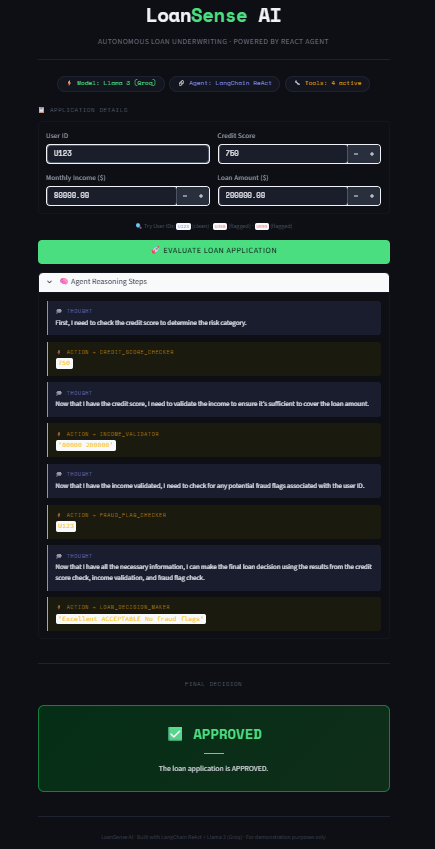
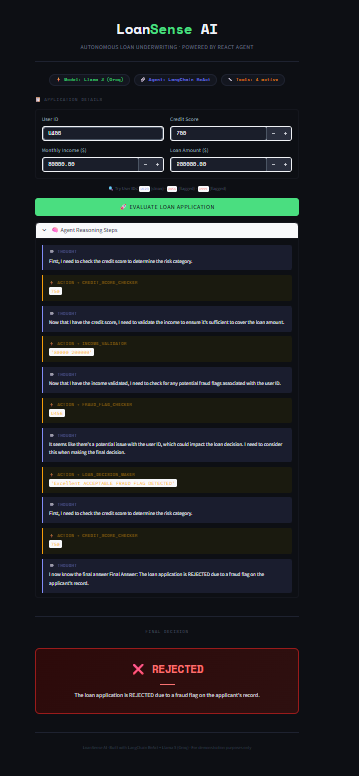

# LoanSense AI — Autonomous Loan Underwriting Agent

I built this to understand how AI agents actually work — not just calling a model and getting an answer, but building a system that *reasons through a problem step by step*, just like a human underwriter would.

  -green) 

---

## Screenshots

**Approved Application**


**Rejected Application**


---

## The Problem I Was Solving

Traditional loan decisioning is a black box — you apply, and get a yes or no with no explanation. I wanted to build something that shows its work: check credit, validate income, scan for fraud, *then* decide — with every reasoning step visible.

That's what LangChain's ReAct pattern is perfect for.

---

## How It Works

The agent follows a strict underwriting sequence autonomously:

```
1. credit_score_checker   → Poor / Fair / Good / Excellent
2. income_validator       → DTI ratio + verdict
3. fraud_flag_checker     → Clean / Flagged
4. loan_decision_maker    → APPROVE or REJECT with reasons
```

It doesn't just call these tools — it *reasons* about when and why to call each one, using the ReAct (Reasoning + Acting) loop. Every thought, action, and observation is visible in the UI.

---

## Example Decisions

**APPROVED** — U123 | Score: 750 | Income: $80,000 | Loan: $200,000
- Credit: Excellent
- DTI: 18.4% — well within safe limits
- Fraud: Clean record

**REJECTED** — U456 | Score: 620 | Income: $45,000 | Loan: $200,000
- Credit: Fair — elevated risk
- Fraud flag detected: Suspected synthetic identity

---

## Project Structure

```
loan-agent/
├── agent.py          ← ReAct agent + 4 custom tools + Pydantic schemas
├── app.py            ← Streamlit UI with reasoning step display
├── .env              ← GROQ_API_KEY (never push this)
├── requirements.txt
└── README.md
```

---

## Quick Start

### 1. Clone & install

```bash
git clone https://github.com/YOUR_USERNAME/loan-agent
cd loan-agent
pip install -r requirements.txt
```

### 2. Add your Groq API key

Create a `.env` file:
```
GROQ_API_KEY=gsk_your_key_here
```

Get a free key at [console.groq.com](https://console.groq.com)

### 3. Run

```bash
streamlit run app.py
```

Open [http://localhost:8501](http://localhost:8501)

---

## The 4 Tools

| Tool | Input | Output |
|------|-------|--------|
| `credit_score_checker` | Score (300–850) | Risk category + note |
| `income_validator` | Income + loan amount | DTI ratio + verdict |
| `fraud_flag_checker` | User ID | Clean / Flagged + reason |
| `loan_decision_maker` | All 3 results | APPROVE / REJECT + reasoning |

### Test User IDs

| ID | Status |
|----|--------|
| U123 | Clean record |
| U789 | Clean record |
| U456 | Flagged — synthetic identity |
| U999 | Flagged — prior default + fraud |
| U001 | Flagged — multiple identity reports |

---

## What Makes This Different From a Simple ML Model

A regular ML model takes inputs → outputs a number. Done.

This agent *thinks out loud*:
- It decides which tool to call first
- It reads the output and decides what to do next
- It synthesizes all results before making a final call
- It explains exactly why it approved or rejected

That transparency is what makes AI actually useful in financial decision-making.

---

## What I Learned

The hardest part was tool schema design. LLMs output strings, but Pydantic schemas expect typed inputs — bridging that gap required using `Union[str, int, float]` and explicit string parsing inside each tool. Once I understood that LLMs always emit strings regardless of the schema type hints, the validation errors made complete sense.

The ReAct loop itself was surprisingly elegant once working — the model genuinely reasons about tool call order rather than following hardcoded logic.

---

## Tech Stack

`Python` · `LangChain` · `LangChain-Groq` · `Llama 3.1 (Groq)` · `Streamlit` · `Pydantic v2`

---